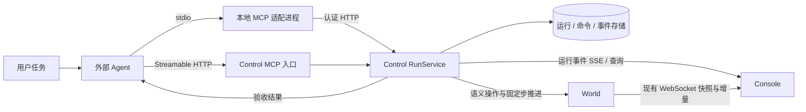

# 外部 Agent 通过 MCP 执行任务与 Console 观测方案

状态：第一阶段已落地，后续阶段仍为设计提案。日期：2026-11-16。实际开放范围、配置与兼容矩阵见[接入指南](mcp-agent-guide.md)。

本次实现新增任务级 HTTP MCP、stdio、事务运行与事件存储、World 幂等创建/推进、Console 运行面板及时间线；首期开放园区场景和 `agent` 执行模式，并提前提供暂停/恢复。OAuth、多控制者和自定义目标留待后续阶段。以下内容保留总体设计，具体 API 以共享工具 Schema 与接入指南为准。

## 1. 推荐方案

在现有 Rust Control 内增加面向任务运行的 MCP 入口：**外部 Agent 理解任务、制定计划和调用工具；Control 管理运行、凭据、推进和记录；World 执行并验证结果；Console 实时展示同一次运行。**

默认工作流是外部 Agent 亲自决策。用户在 Agent 端输入“完成园区巡检、备件运输、维修与复核”，Agent 创建运行，观察世界，分配设备，提交动作，分段推进，直到服务端验收成功。接入不要求 Agent 使用本仓库 SDK，也不要求在 Control 内配置模型密钥。

“任意 Agent”的兼容范围是支持已声明 MCP 版本、工具调用和一种受支持传输的客户端。提供 Streamable HTTP 和 stdio 两种接入方式；客户端配置格式、OAuth 支持和可持续调用工具的轮数仍由各客户端决定。MCP 提供执行能力，不能保证宿主 Agent 在停止生成后还会继续规划。

另保留现有 Runner 的委托执行模式：外部 Agent 可以启动一个服务端已有策略的实验，再查询结果。它与 Agent 亲自控制是两种执行来源，应在 Console 明确标记。首期交付以亲自控制为主。

## 2. 现状与缺口

| 能力 | 当前实现 | 本次需要补充 |
| --- | --- | --- |
| MCP 接入 | `packages/control-server/src/main.rs` 已用 RMCP 提供 `/mcp` | 任务级工具、stdio 接入、客户端兼容验证 |
| MCP 工具 | `observe_agent`、`submit_action`、`cancel_action`、`send_agent_message` | 场景发现、运行创建、指挥分配、推进、查询和验收 |
| 运行管理 | `runner.rs` 已有队列、租约、独立 World 会话、观察凭据、归档 | 支持 `external_mcp` 执行者，抽取共享 RunService |
| 世界执行 | World 支持外部指挥，`auto` / `agent` / `primitive` 执行模式，动作校验和固定步长 | 增加推进命令的幂等与版本前置条件 |
| Console | Runner 面板可观察运行与打开回放；`app.html` 已连接 World WebSocket | 外部 Agent 运行列表、深链接、工具时间线与目标进度 |
| 持久化 | Runner 状态与回放存盘，World 活动会话在内存 | 持久化运行事件、命令去重、恢复与中断状态 |

需要特别处理的现有约束：

- MCP 工具现在直接转发 World 设备 Token。Runner 发出的设备 Token 则是 Control 代理凭据，两者不能直接互换。
- Runner 当前租约 15 秒，配置超时上限 300 秒，不适合直接套用到有较长思考间隔的交互式 Agent。
- Runner 创建会话固定使用 `dispatchMode=external`、`executionMode=primitive`。任务级 MCP 首期建议使用 `executionMode=agent`，让一次 `execute_task` 承担设备的导航与作业。
- Runner 当前完成校验面向整个场景：`world.done && !world.failed`。指定任务子集需要独立的目标验收逻辑。
- Console 当前能看世界结果，但没有自动记录任意 MCP 工具调用；Agent 的计划和摘要也不会自动进入 World 事件。
- 现有 MCP 集成测试使用 `2025-11-25` 握手。`Cargo.toml` 声明 RMCP `3.8`，锁文件实际为 `3.9.0`；不能据此直接认定所有新旧协议客户端都兼容。

## 3. 架构与运行边界



沿用同一个 `runId` 贯穿 MCP、运行存储、Console 和归档。`worldSessionId` 只用于关联 World；MCP 传输会话 ID 不参与业务身份和生命周期。

| 组件 | 职责 |
| --- | --- |
| MCP Adapter | 协议、参数 Schema、身份上下文、工具结果；调用共享业务服务 |
| RunService | 创建运行、权限与执行者校验、命令串行化、状态流转、取消和收尾 |
| ExternalRunDriver | 按 Agent 的推进请求执行有上限的步数；不自行生成计划 |
| ObjectiveEvaluator | 把 World 权威状态与预先锁定的目标条件比较，生成验收证据 |
| RunEventStore | 保存工具调用、操作结果、摘要与 World 事件索引；支持补拉与回放关联 |
| World | 设备能力、有限观察、路径、动作、任务状态和物理规则的最终裁决 |
| Console | 运行选择、三维观察、目标进度、执行时间线、取消和回放 |

首期每个运行拥有独立 World 会话、一个外部控制者和一个时钟所有者。Console 观察连接不驱动仿真；关闭浏览器不会结束运行。已有 Runner 继续使用自己的协议，通过共享业务层逐步复用生命周期和归档。

## 4. 用户流程

1. 管理员在 Console 的“Agent 接入”中签发接入凭据，限定场景、可控制角色、并发和运行预算，并复制 MCP 配置。
2. 用户把 Control 配置到 Agent，在 Agent 端提出目标。
3. Agent 调用 `box_get_capabilities`，获取可用场景、任务、设备角色、动作 Schema、观察权限和预算范围。
4. Agent 调用 `box_create_run`，提交原始目标及结构化验收条件；得到 `runId`、当前状态、`consoleUrl` 和下一步指引。
5. Agent 循环执行观察、分配、提交动作与分段推进。工具返回可执行候选项、错误码和下一步信息，减少对场景内部知识的依赖。
6. Console 通过运行链接打开同一会话；三维场景显示设备行为，时间线显示工具调用、摘要、分配和执行结果。
7. Control 在推进后检查目标。满足条件后进入收尾，冻结后续写入，归档并返回可验证结果；不满足时返回尚未完成的条件。

首期自然语言目标映射到已有场景和任务。支持任务 ID 集合与场景全部完成，不把任意自然语言字符串直接当作可执行任务。场景不支持的目标或约束需要 Agent 澄清或明确返回不支持，不能默默忽略。自定义任务生成和场景编辑后续扩展。

## 5. MCP 工具契约

新增任务入口建议为 `/mcp/control`。现有 `/mcp` 保持设备工具兼容；两个入口使用不同的身份校验与工具目录。`/mcp/control` 是业务入口名称，与 MCP 协议版本无关。

### 5.1 首期工具

| 工具 | 核心参数 | 结果与语义 |
| --- | --- | --- |
| `box_get_capabilities` | 可选 `scene_id` | 可用场景、目标类型、权限、动作 Schema、限制、调用示例 |
| `box_create_run` | `request_id`、`scene_id`、`objective`、`config` | 幂等创建独立运行，返回 `run_id`、版本、Console 链接 |
| `box_get_run` | `run_id` | 状态、目标进度、预算、当前操作、归档状态；终态含验收结果 |
| `box_observe` | `run_id`、`view`、可选 `agent_id` | 指挥或设备的授权观察、World revision、候选任务和设备 |
| `box_assign_task` | `run_id`、`request_id`、`expected_revision`、`task_id`、`agent_id` | 通过协调器语义接口分配任务，不调用管理员强制分配 |
| `box_submit_action` | `run_id`、`agent_id`、`action` | 提交类型化动作，返回 World 接受/拒绝及操作 ID |
| `box_cancel_action` | `run_id`、`agent_id`、`request_id`、`action_request_id` | 取消指定动作；已完成动作保持原结果 |
| `box_advance` | `run_id`、`request_id`、`expected_revision`、`max_ticks`、`until` | 有限推进，返回实际 tick 范围、停止原因、变化摘要和目标进度 |
| `box_record_note` | `run_id`、`request_id`、`kind`、`text` | 记录可选计划、决策摘要、阶段进展；标记为 Agent 自述 |
| `box_get_events` | `run_id`、`after_seq`、`limit` | 分页读取持久运行事件，提供下一页游标 |
| `box_cancel_run` | `run_id`、`request_id`、`reason` | 请求停止、冻结后续写入并归档；可重复调用 |

所有修改运行的工具携带服务端返回的 `control_epoch`。`box_create_run` 创建初始 epoch；取消、管理暂停或更换控制者时递增。恢复和控制者转移在后续阶段通过显式接口实现，不能由普通观察调用自动抢占。

`action` 在共享 Schema 中按 `type` 定义参数，覆盖现有 `move`、`scan`、`charge`、`execute_task`、`work_task`、`rescue`。首期暴露当前模式允许的子集。低层 `primitive`、消息和更多任务提案能力可按权限加入，不能假定所有动作在所有模式都可用。

观察默认使用 World 的设备/协调器范围，不将服务端用于验收的管理员快照直接返回 Agent。Console 的全局观察权与外部 Agent 的控制、读取范围分开授权。

### 5.2 创建示例

以下是拟议契约，不是当前已可调用的接口：

```json
{
  "request_id": "park-maintenance-001",
  "scene_id": "industrial-park-v2",
  "objective": {
    "instruction": "完成园区巡检、异常确认、备件运输、维修和复核",
    "type": "all_tasks_done",
    "task_ids": ["inspect", "confirm", "deliver", "repair", "verify"]
  },
  "config": {
    "seed": 42,
    "physics_mode": "kinematic",
    "execution_mode": "agent",
    "dispatch_mode": "external",
    "max_ticks": 3000,
    "max_wall_seconds": 1800,
    "idle_timeout_seconds": 300
  }
}
```

`all_tasks_done` 指上述任务集合全部完成；另设 `scene_completed` 表示完整场景结束。创建时验证任务存在及依赖闭包：完成 `repair` 可能必须先执行 `inspect → confirm → deliver`，不能把目标集合误认为可跳过前置任务。结构化目标及其版本在运行创建后锁定。

成功结果统一返回 `structuredContent`，并提供相同数据的 JSON 文本兼容现有客户端。例如：

```json
{
  "run_id": "run-uuid",
  "status": "running",
  "phase": "waiting_for_agent",
  "control_epoch": 1,
  "world_revision": 0,
  "console_url": "https://console.example.com/#run=run-uuid",
  "event_cursor": 2,
  "next_actions": ["box_observe"]
}
```

工具错误使用 `isError: true` 并返回 `code`、`message`、`retryable`、`run_id` 和可用的最新版本。协议/认证错误使用对应 MCP 或 HTTP 错误。典型业务错误包括 `objective_unsupported`、`revision_conflict`、`run_not_writable`、`action_rejected`、`budget_exhausted`、`world_unavailable`。没有收到上游响应时返回 `outcome_unknown`，不能假称动作失败再生成新请求 ID 重试。

Resources、Prompts 可提供帮助文档、场景说明和推荐循环，但执行闭环只依赖 tools，避免把客户端可选功能作为前提。

## 6. 仿真推进与完成判定

### 6.1 默认决策回合

外部模式采用 `dispatchMode=external`、`executionMode=agent`。Agent 先用 `box_assign_task` 分配，再对所选设备提交 `execute_task`，World 负责该动作的路径和作业。首期不启动内置规划器与外部 Agent 争抢分配。

```text
observe → assign_task → submit_action(execute_task)
        → advance(until=action_finished / task_finished / failure)
        → observe → 下一轮决策
```

一轮可以给多台设备提交动作，然后共同推进。分配和动作是两个独立命令：如果分配成功而动作失败，保留“已分配、待执行”状态并显式返回；首期不承诺跨命令事务或失败时撤销所有先前操作。

`box_advance` 建议首期每次最多 100 tick、2 秒墙钟时间，以先到者为准，参数受服务端上限约束。它在 Control 内逐个调用 World 单步推进，每步检查取消、预算和停止条件，并让现有 World 流发送变化。返回 `max_ticks`、`wall_budget`、`event` 或 `terminal` 等明确停止原因。初次调用把传入的 `expected_revision` 与当前 World 版本比较，后续每步由唯一驱动者更新版本。

展示速率单独配置为 1× / 2× / 5×，不改变仿真固定步长，也不把 Agent 思考时间算成仿真时间。没有 `advance` 调用时世界保持不动，Console 显示“等待 Agent 下一步”；避免把这种状态错误显示为设备持续运行。用户希望无人值守持续规划时，应显式选择已有 Runner 或另行部署 Agent 执行器。

所有观察工具无推进副作用。MCP 请求断开后，正在推进的短操作在单步边界停止；已发生的效果保留并可查询，不因网络断线删除运行。业务上的持久运行与传输请求取消是不同层次。

### 6.2 状态机、超时与取消

主状态沿用 `queued → starting → running → stopping → completed / failed / cancelled / timeout`；外部即时运行通常从 `starting` 开始。增加运行阶段 `waiting_for_agent`、`advancing`、`paused`、`reconciling`，不让一次工具调用结束变成整个运行结束。

- Agent 普通思考期间没有后台心跳要求。只由该运行控制者的有效调用更新交互活跃时间，Console 订阅和旁观者查询不续期。
- 建议默认 5 分钟无控制者交互进入 `paused`，30 分钟总墙钟预算结束运行；实际值受接入凭据的额度限制。恢复需验证原控制者、World 仍存在并签发新 epoch。
- 15 秒 Runner 租约继续约束 Runner 执行者；不得通过伪造 Runner 心跳让外部模式无限续约。
- Console 取消先持久化 `desired_status=cancelled` 并提高 epoch，再由驱动器在单步边界收尾；取消接口不等待整段推进的互斥锁。已经提交的单步允许结算，随后禁止新动作及推进。
- 已验收的终态不会被迟到的取消改写。目标完成和取消的先后由 RunService 的串行状态提交决定。
- World 不可用时进入中断处理并保存已有证据，不能把“没有继续执行”解释成成功。

### 6.3 验收

ObjectiveEvaluator 读取权威 World 状态，而不是 Agent 自述：

1. 所有目标任务满足规定状态，必要依赖已完成。
2. 完整场景目标要求 `world.done=true && world.failed=false`；子集目标独立计算，不强求整个场景结束。
3. 支持的约束逐一核验；首期不接受尚无 evaluator 的指标或任意表达式脚本。
4. 固化验收时的 tick、revision、目标哈希、每项条件、证据索引、失败原因及运行时指纹。

目标满足后停止推进并收尾。任务结果和归档状态分开保存：归档失败显示 `archive_status=failed`，不伪造可用回放，也不反转已经有权威证据的任务验收结果。保留当前回放“完整/部分历史”的覆盖信息。

## 7. Console 中看到什么

### 7.1 两条数据流

复用现有 World WebSocket `/stream` 绘制三维状态；增加独立的运行事件流展示工具与任务过程。不要把 MCP 传输的 SSE 当成浏览器观测总线。

拟议业务 HTTP API：

| 路由（Console 同源前缀 `/control`） | 用途 |
| --- | --- |
| `GET /runs/v1/capabilities` | 当前身份可用的场景、目标、工具参数和限制 |
| `GET /runs/v1/runs`、`GET /runs/v1/runs/:runId` | 按调用者授权列出、读取运行 |
| `POST /runs/v1/runs` | stdio 适配器和其他入口调用同一创建契约 |
| `POST /runs/v1/runs/:runId/commands/:command` | 有类型的命令白名单，复用 MCP 校验与幂等规则 |
| `GET /runs/v1/runs/:runId/observations` | 按身份和指定视角返回观察 |
| `POST /runs/v1/runs/:runId/observer` | 为有查看权限的用户取得只读 World 观察访问 |
| `GET /runs/v1/runs/:runId/events?after=...&limit=...` | 分页补拉历史 |
| `GET /runs/v1/runs/:runId/events/stream?after=...` | 运行事件 SSE |
| `GET /runs/v1/runs/:runId/result`、`.../report` | 验收结果、可用回放 |

业务 API 的查询和命令权限分别校验，不能暴露任意 World 路径转发。Console 用带认证头的 fetch 读取 SSE；如后续使用原生 EventSource，则改用同源安全 Cookie，不能把 Token 放进 URL。

每条运行事件至少包括：

```json
{
  "schema_version": 1,
  "run_id": "run-uuid",
  "seq": 27,
  "kind": "tool.completed",
  "source": "external_agent",
  "actor_id": "principal-uuid",
  "call_id": "call-uuid",
  "command_id": "command-uuid",
  "request_id": "repair-action-001",
  "world_session_id": "session-uuid",
  "world_revision": 81,
  "tick": 67,
  "occurred_at": "2026-11-16T06:00:00Z",
  "payload": {"tool": "box_submit_action", "outcome": "accepted"}
}
```

事件类型覆盖 `run.*`、`tool.started/completed/failed`、`agent.note`、`command.*`、`objective.updated/evaluated` 和必要的 `world.event` 索引。`call_id` 表示一次网络尝试，`command_id` 表示幂等业务命令，多个重试可以关联同一命令。

工具事件自动记录参数摘要、起止时间、耗时、接受/拒绝结果和关联动作。敏感字段在落盘前脱敏，单条 payload 有大小上限；大型观察以受同等权限保护的引用保存，不反复塞进实时流。接入名称取自已认证主体，客户端自报的名称只作展示标签。

`seq` 在单个运行内递增。World revision、World event seq 和运行 seq 属于不同序列，不能混用。通过 revision/tick/原 World 事件 ID 关联两个视图；未取得 World 版本的调用显示“待确认”，不能按到达时间伪造因果顺序。

事件先落盘再推送，SSE 使用业务事件 ID 与游标补拉，交付语义为至少一次，前端按 `(runId, seq)` 去重。先读取快照及事件水位，再订阅水位后的事件，避免首次连接丢消息。超过保留窗口明确返回 `cursor_expired` 与可用范围并要求重新同步；慢客户端断开后补拉，不无限缓存。

### 7.2 页面变化

- 增加“Agent 任务”入口，与 Runner 运行共用运行卡片和状态展示。
- 顶部显示目标、接入身份、执行来源、阶段、已完成条件、tick 和时间预算。
- 三维场景继续展示设备、路线、动作和任务状态；点击时间线事件跳到对应设备、任务或回放帧。
- 时间线分辨“Agent 提交摘要”“Control 调用记录”“World 执行事实”；工具被接受不等于动作已完成。
- 支持 `#run=<runId>` 深链接。打开链接后校验 Console 身份，再获取观察凭据；链接本身不授予访问权。
- 管理暂停、恢复、取消经过 RunService；不允许 Console 和外部 Agent 同时独立推进同一会话。

MCP 只能自动记录经过 Control 的工具输入输出和世界变化。外部 Agent 的聊天内容、隐藏推理或其他工具调用不会自动可见；需要展示的计划和解释通过 `box_record_note` 或命令的可选摘要字段提交。摘要不是验收依据。

## 8. 运行数据与一致性

建议抽出存储接口，以 SQLite WAL 作为单实例 Control 的事务存储。新增依赖和迁移是本次实现范围的一部分；当前 `runner-state.json` 不能直接作为高频事件数据库使用。

| 数据 | 关键字段 |
| --- | --- |
| `runs` | ID、owner、executor_kind、配置、目标及哈希、状态/阶段、epoch、World 会话、预算、结果与归档状态 |
| `run_commands` | run、工具、request_id、参数哈希、状态、World 请求 ID、已提交效果、结果 |
| `run_events` | run、seq、来源、kind、call/command 关联、tick/revision、脱敏 payload |
| `integration_credentials` | Token 哈希、主体、范围、配额、过期与撤销状态 |
| `artifacts` | run、类型、路径/对象键、摘要、大小和历史覆盖范围 |

将现有 Runner 的生命周期/存储提取为共享接口，保留原 `/runners/v1` 契约。存储迁移采用有版本的一次性导入，先备份、验证全部记录及回放引用，再切换；失败时启动失败并保留原文件，不能让 JSON 与 SQLite 成为两个可写权威源。现有回放文件无需改写。

一致性规则：

1. 修改操作以 `(principalId, runId, tool, requestId)` 去重；创建运行以 `(principalId, requestId)` 去重。同 ID 同参数返回原结果，不同参数返回冲突。认证和资源访问校验通过后，先查既有命令，再校验新写入的 epoch，保证迟到重试仍可读取原结果。已完成运行仍保留去重记录至运行保留期结束。
2. 每个运行串行执行修改命令，读取可并发；每次在执行前重新校验 epoch、状态和 World revision。
3. 先事务写入命令意图和开始事件，再调用 World，再事务记录结果、运行变化与完成事件。数据库事务不能覆盖远端 World，必须处理“World 已执行、Control 尚未落结果”的间隙。
4. 动作/协调器命令使用 World 现有 requestId 去重。World `/step` 需要新增 `requestId + expectedRevision` 和可查询回执，按单步确认，禁止不确定时盲目重试。World 会话创建也需要关联 Control 的创建 operation ID，以便响应丢失后查回同一会话。
5. `box_advance` 的各步使用可重建的子命令 ID；中断后恢复已提交步数。运行进入 `reconciling` 时冻结新写入，直到查清结果；不能重放整段推进。
6. Control 重启时先恢复命令与状态，再判断 World 会话是否仍存在。World 存活可以核对后继续；World 重启导致会话消失时标记 `failed/world_session_lost` 并提供已有历史，不能承诺无损续跑。持久快照创建分支应是显式的新运行。
7. 任务结果、事件和回放都有独立覆盖范围。回放只保存后半段时，Console 明确标记部分历史。

首期部署为单个 Control 写实例。需要多副本时再引入共享数据库、分布式运行锁和 fencing；不能仅增加多个 HTTP 副本后共同操作本地 SQLite 与 World 时钟。

## 9. 接入与认证

### 9.1 Streamable HTTP 与 stdio

远程客户端使用 `https://<control-host>/mcp/control`，也可通过 Console 同源代理访问 `/control/mcp/control`。客户端支持自定义认证头时发送接入 Token；接入 Token 是 Control 凭据，不是 World 管理员、设备或 Runner Token。

仅支持 stdio 的客户端启动本地适配器，适配器通过认证业务 API 调用同一个 RunService。建议在 Rust 项目增加独立二进制 `threebox-mcp-stdio`，复用工具定义与结果类型，不启动另一套 World 或业务数据库。

示意配置如下，具体字段依客户端而定；该二进制尚待实现，路径、地址和凭据均需替换：

```json
{
  "mcpServers": {
    "3dbox": {
      "command": "/absolute/path/threebox-mcp-stdio",
      "env": {
        "BOX_CONTROL_URL": "http://127.0.0.1:8789",
        "BOX_CONTROL_TOKEN": "<integration-token>"
      }
    }
  }
}
```

适配器 stdout 只输出 MCP 消息，日志走 stderr。宿主终止适配器时，Control 保留业务运行并按空闲/总预算处理。所有凭据从环境、受保护配置或客户端密钥存储获得，不作为模型工具参数。

### 9.2 身份与边界

- 首期受控部署使用管理员签发、可撤销、带范围和配额的接入 Token；只保存外部 Token 哈希。需要调用 World 的内部凭据保存在服务端受保护的秘密存储中，不写入事件或报告。
- Control 身份映射到运行 owner 和允许的设备/协调器范围，服务端代持 World 凭据并调用相应角色接口。不能把接入 Token 原样透传给 World。
- World 管理凭据只用于创建、推进、验收与归档；设备动作仍用设备凭据，指挥仍用协调器凭据。
- 通用远程 OAuth 客户端接入需补全 MCP Authorization 的授权发现、资源元数据、Token audience 和 scope 校验；静态 Token 本身不等于完成标准 OAuth 接入。[官方授权规范](https://modelcontextprotocol.io/specification/2026-07-28/basic/authorization)
- 远程入口使用 HTTPS，直接 Control 和代理入口均验证 Host/Origin、请求大小和速率。公网只开放已认证的必要路由，当前无认证的 `POST /sessions` 不随新入口一同公开。
- Console 接入页复用现有 operator 授权管理凭据；深链接观察与运行事件读取必须校验用户权限。普通观察者不能使用管理员控制能力。
- 兼容入口的 `CONTROL_AGENT_TOKEN` 仅维持原有受信本地用途，新入口不采用进程级默认身份。

### 9.3 协议版本策略

截至本次设计，官方 `latest` 指向 `2026-07-28`。该修订采用逐请求元数据，Streamable HTTP 移除了协议会话和 GET 流；旧客户端仍存在基于 `initialize` 的会话模型。必须分别验证兼容路径，不能把现有测试通过等同于新版兼容。[官方传输总览](https://modelcontextprotocol.io/specification/2026-07-28/basic/transports)

- 将现有 `2025-11-25` 作为已存在的回归基线；增加 `2026-07-28` 契约测试，再决定锁定 RMCP 版本是否需要升级或补适配。发布时列出实际通过的版本和传输组合。
- 新版 HTTP 所需的 `Mcp-Method`、`Mcp-Name` 等元数据头必须经过 Console 代理；旧版的会话头继续在兼容路径保留。SSE 禁缓冲、取消、认证响应头及断线行为一并测试。[官方 Streamable HTTP 规范](https://modelcontextprotocol.io/specification/2026-07-28/basic/transports/streamable-http)
- 核心工具使用短请求加持久 `runId`，不依赖 MCP Tasks。Tasks 当前为需客户端显式支持的扩展；后续可把长时归档或委托实验映射为扩展任务，普通工具查询仍可用。[官方 Tasks 扩展](https://modelcontextprotocol.io/extensions/tasks/overview)
- Console 的业务 SSE 补拉协议自行定义，与新版 MCP 是否支持 SSE `Last-Event-ID` 无关。

## 10. 代码改动位置

以下新文件名为建议，现有模块在拆分时保持行为回归：

| 位置 | 改动 |
| --- | --- |
| `packages/control-server/src/main.rs` | 装配旧/新 MCP、身份中间件与业务 HTTP 路由 |
| `packages/control-server/src/mcp/`（新增） | 任务工具 Schema、映射、协议兼容与错误转换 |
| `packages/control-server/src/run_service.rs`（新增） | 通用运行生命周期、执行者接口和权限校验 |
| `packages/control-server/src/external_run.rs`（新增） | 外部运行、串行命令、分段推进与取消 |
| `packages/control-server/src/objective.rs`（新增） | 目标解析、依赖检查和权威验收 |
| `packages/control-server/src/run_store.rs`（新增） | SQLite、迁移、命令/事件事务及恢复 |
| `packages/control-server/src/runner.rs` | 复用共享服务，维持 Runner v1 路由和行为 |
| `packages/control-server/src/bin/threebox-mcp-stdio.rs`（新增） | stdio 适配器；需要提取可复用库模块 |
| `packages/control/schemas/` | 运行、目标、事件和类型化动作契约 |
| `packages/control/src/control-http-forward.js` | 协议/授权响应头、SSE 行为与代理契约 |
| `packages/world/server/world-server.js` 及对应 Supervisor/Worker 路由 | 创建/推进命令的幂等回执与 revision 校验 |
| `packages/console/src/agent-run-panel.tsx`（新增） | 外部运行列表、详情、接入配置与控制 |
| `packages/console/src/run-timeline.tsx`（新增） | 工具与任务时间线、游标恢复、回放关联 |
| `packages/console/src/mission-control.tsx`、`app.html` | 运行入口、深链接、复用 observer 和三维状态流 |
| `tests/integration/` | MCP 跨版本、外部执行、事件恢复、权限和取消验收 |

## 11. 交付顺序与验收

| 阶段 | 交付 | 退出条件 |
| --- | --- | --- |
| P0：兼容与领域基础 | 共享 RunService/存储接口、外部身份、目标契约、协议版本探针 | 原 Runner 与四个 MCP 工具回归通过，确认实际兼容版本 |
| P1：执行与观测闭环 | HTTP 任务 MCP、stdio、`agent` 模式、分段推进、目标验收、事件时间线、Console 深链接 | 用户从外部 Agent 完成园区五任务链，Console 全程可看并有结果/回放 |
| P2：可靠接入 | OAuth 接入、暂停恢复、连接配置体验、更多宿主验证及更完整的故障演练 | 目标客户端兼容矩阵通过，撤销/恢复/重启行为符合契约 |
| P3：扩展 | 委托 Runner 工具、多 Agent 分工、primitive 控制、自定义目标和可选 Tasks 扩展 | 按具体场景分别验收 |

持久事件、权限隔离、幂等推进和取消是 P1 的必要条件，不能作为仅有演示成功后的补丁。

核心验收用例：

1. HTTP MCP 和 stdio 各通过一个独立通用客户端完成创建、分配、动作、推进、验收；只实现 tools 的客户端也能完成闭环。
2. Agent 的操作与 Console 世界状态属于同一 `runId`；工具开始/结果及 World 变化在本地环境下以低于 1 秒为事件可见延迟目标。
3. Agent 思考 60 秒不会被 15 秒 Runner 租约清理，World 显示等待状态；超过规定空闲和总预算按规则收尾。
4. 重复创建/动作/推进使用相同 requestId，不重复执行；相同 ID 不同参数报冲突。模拟 World 执行成功后响应丢失，恢复后也不多推进一步。
5. 两个客户端并发修改、Console 取消与推进竞争时，只接受满足版本和 epoch 的命令；取消后不再发起新单步。
6. Console 刷新、SSE 断线重连和游标过期可正确同步，无静默丢事件；World 帧缺口明确标记。
7. Agent 声称“已完成”但 World 条件未满足时，运行不能进入 `completed`；目标子集完成与场景完成使用不同 evaluator。
8. 用户/运行/设备之间不能越权读取或控制，凭据撤销立即拒绝后续请求，日志和回放不含 Token。
9. Control 重启、World 重启、归档失败分别有明确状态和可用证据；原 Runner 历史和回放在存储迁移后仍可读取。

建议首个示范固定为 `industrial-park-v2` 的 `inspect → confirm → deliver → repair → verify`：已有完整任务依赖、三类设备、三维展示和回放，能直接验证本次需求的完整链路。
